
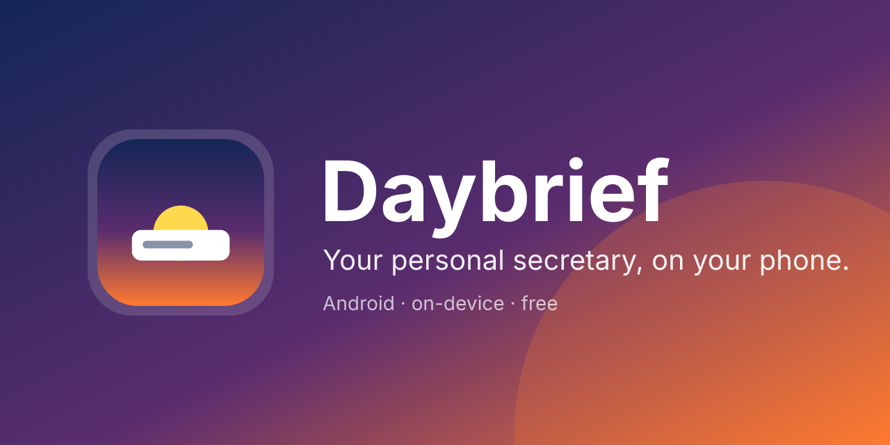

<a href="https://github.com/AnasPotter/daybrief/releases/latest"><b>⬇ Download Daybrief for Android</b></a>

<table>
<tr><td width="33%">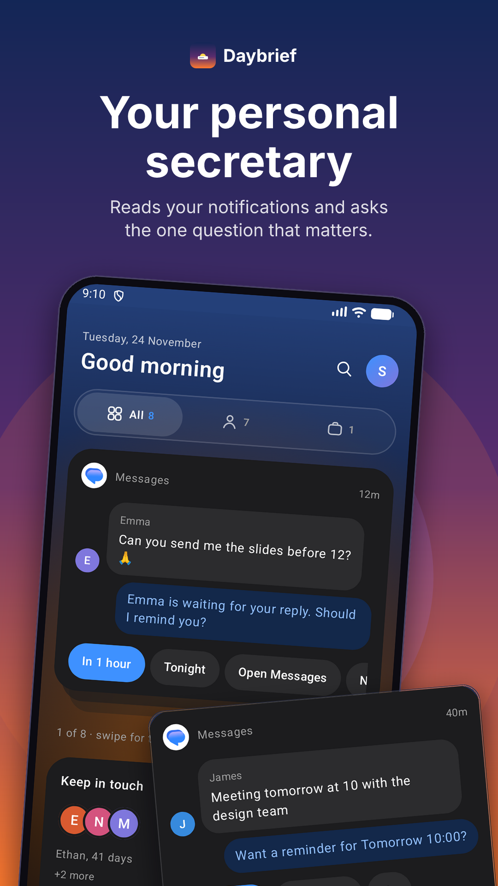</td><td width="33%">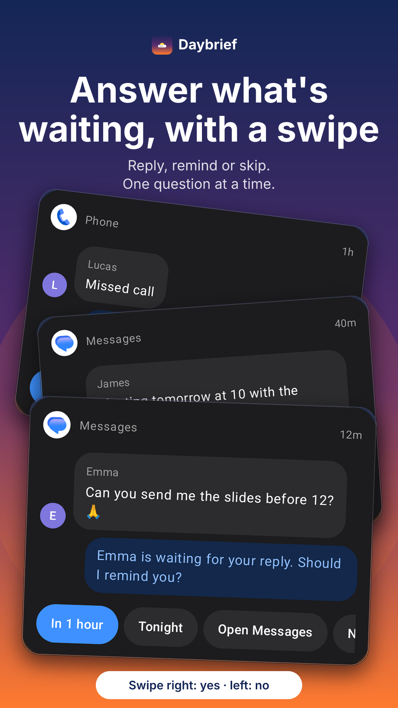</td><td width="33%">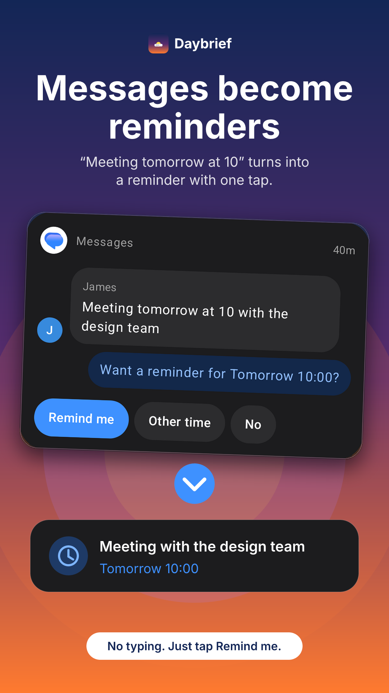</td></tr>
<tr><td width="33%">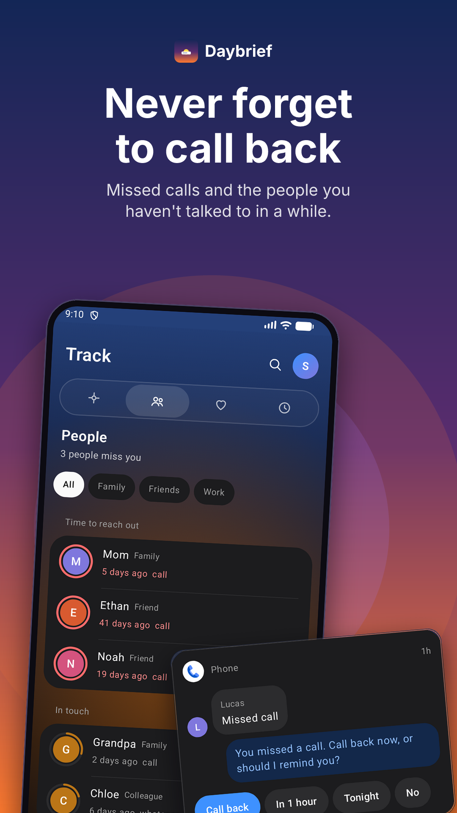</td><td width="33%">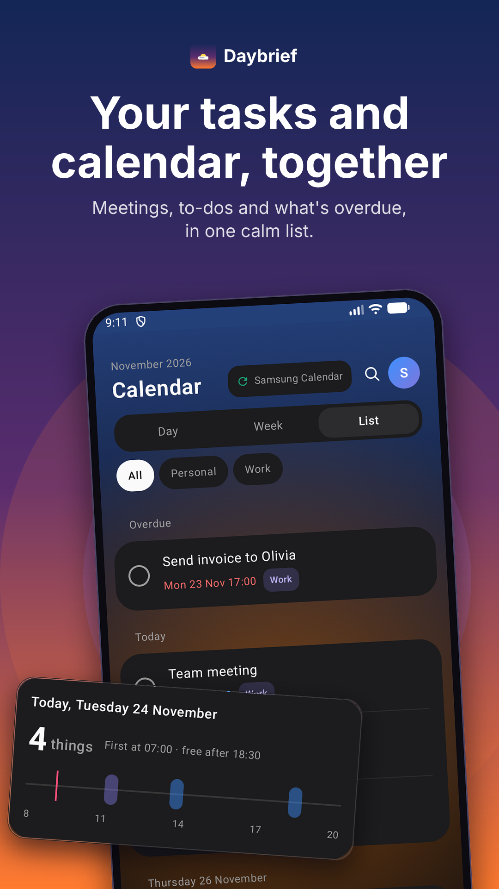</td><td width="33%">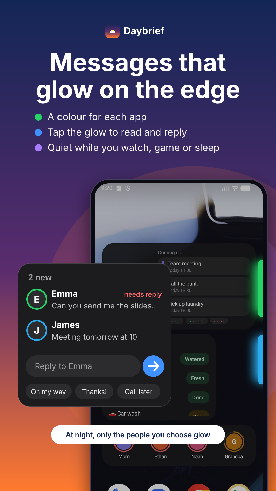</td></tr>
<tr><td width="33%">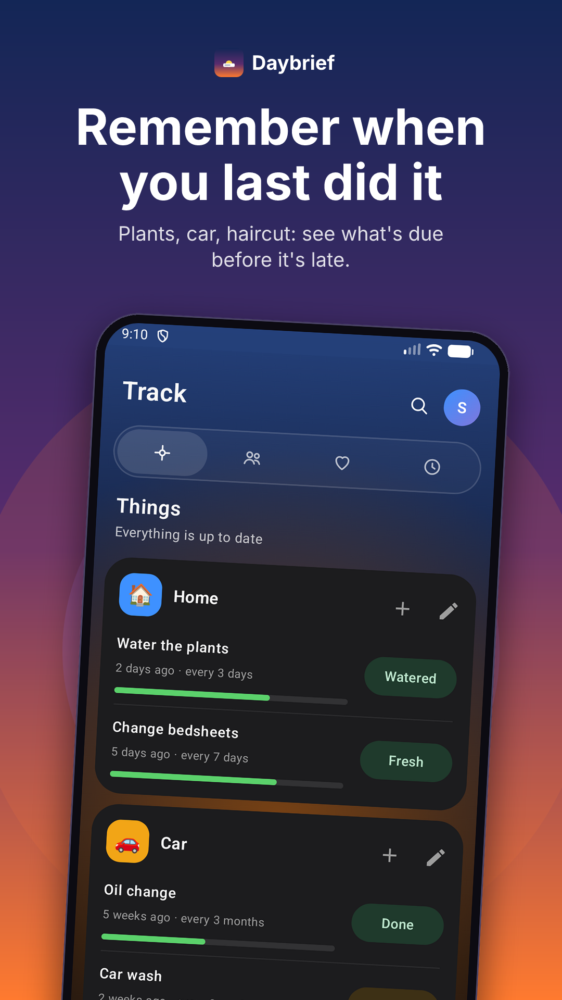</td><td width="33%">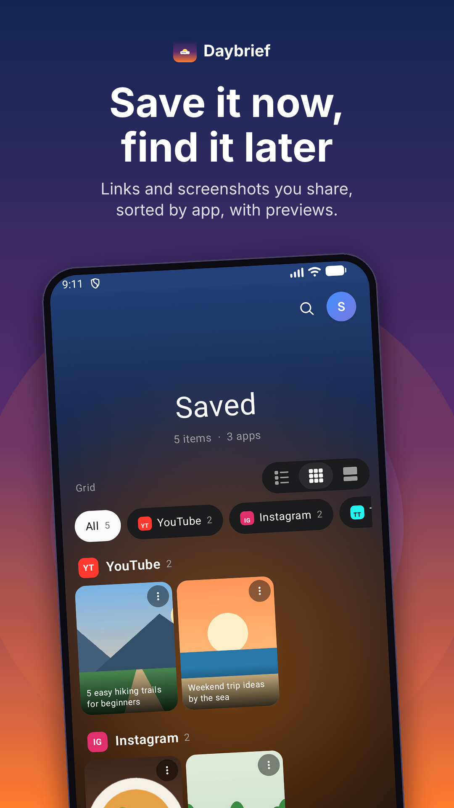</td><td width="33%">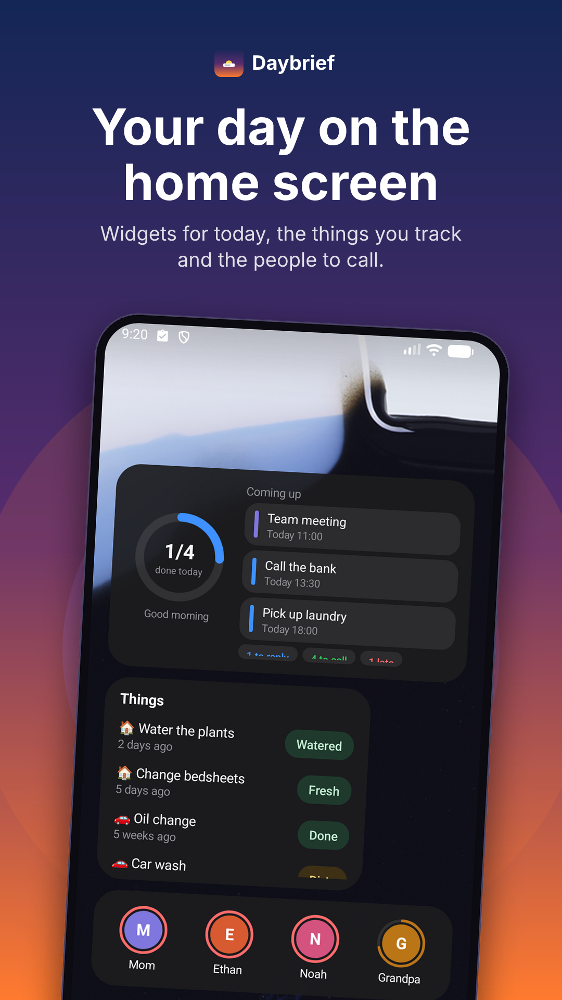</td></tr>
<tr><td width="33%">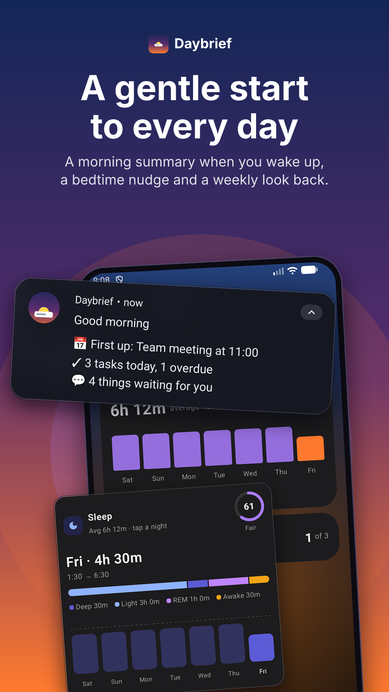</td><td width="33%">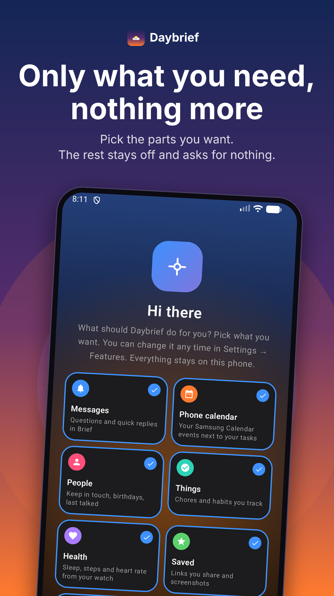</td><td width="33%">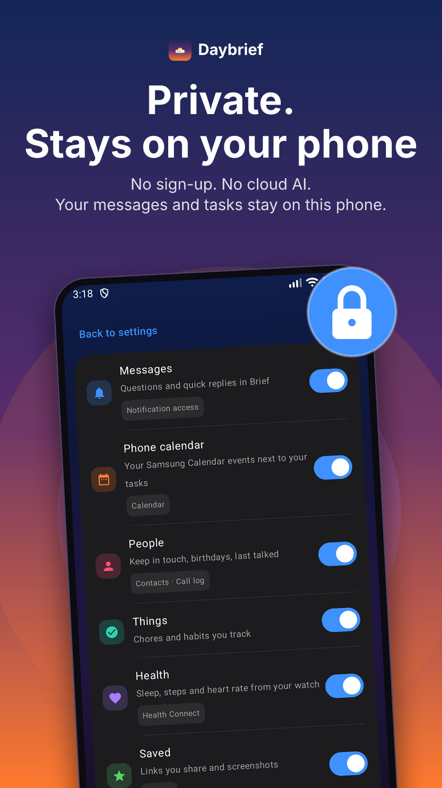</td></tr>
</table>

# Daybrief

Your personal secretary, on your Android phone.

Daybrief reads your notifications and turns them into one short brief: the message that needs a reply, the call you should return, the reminder hiding in "meeting tomorrow at 10". Answer each one with a swipe, and see what's next on your calendar and task list.

**Everything stays on your phone.** No account, no ads, no tracking, no server.

## What it does

Pick only the parts you want. Each one can be switched off in Settings → Features, and a part that's off never asks for its permission.

- **Messages**: the messages that need you, as one question at a time: reply, remind me later, or done
- **Reminders and tasks**: reminders made from your messages, your tasks and your phone calendar together
- **People**: who to call back, keep in touch, birthdays
- **Things**: know when you last did anything (watering plants, car oil, vitamins)
- **Health**: sleep, steps and heart rate from your watch through Health Connect
- **Saved**: links you share and screenshots
- **Edge lighting**: a glow on the screen edge for new messages
- **Your day**: morning summary, bedtime reminder, a lighter day after a short night, and a weekly look back

## Install

1. Open [Releases](https://github.com/AnasPotter/daybrief/releases/latest) on your phone and download **Daybrief.apk**.
2. Open it. Android asks to allow installing apps from your browser: allow it once.
3. Open Daybrief and pick what you want it to do.

Daybrief checks this page for new versions and offers to update itself (Settings → Backup & updates).

Needs Android 8 or newer. Made with Samsung Galaxy phones and One UI in mind, works on other Android phones too.

## Privacy

See [PRIVACY.md](PRIVACY.md). In short: your data never leaves your phone.

## Support

Daybrief is free. If it helps you, you can [support it on Ko-fi](https://ko-fi.com/anaspotter) (PayPal, card or Google Pay).

Found a problem or have an idea? [Open an issue](https://github.com/AnasPotter/daybrief/issues).
